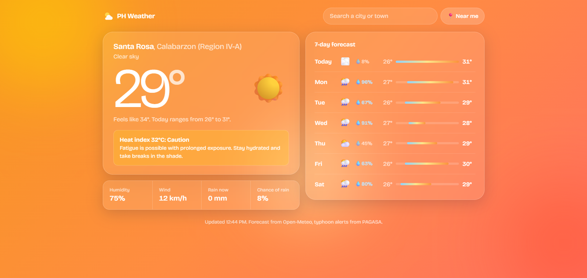

# 🇵🇭 PH Weather Dashboard


A weather dashboard for the Philippines that shows live forecasts for any city or town, warns about dangerous heat using PAGASA's heat index levels, and displays PAGASA tropical cyclone alerts when a storm is inside the Philippine Area of Responsibility.

**🔗 Live demo:** https://ph-weather-dashboard.onrender.com
**🌀 Preview the typhoon alert:** https://ph-weather-dashboard.onrender.com/?test

> Hosted on Render's free tier, so the first load after a period of inactivity may take up to a minute while the server wakes up.



## Why I built this

During typhoon season, checking the weather in the Philippines usually means jumping between a weather app for the forecast and PAGASA's website for official storm bulletins. I wanted one clean, mobile-friendly page that answers two questions at a glance: what's it like outside, and should I worry?

## Features

- **Current weather**: temperature, feels-like, humidity, wind, rainfall, and chance of rain
- **7-day forecast** with temperature range bars, so you can compare days at a glance
- **PAGASA typhoon alerts**: an alert banner appears automatically when a tropical cyclone bulletin is active, with a link to the official bulletin
- **Heat index warnings**: calculated from temperature and humidity, classified using PAGASA's four levels (Caution, Extreme Caution, Danger, Extreme Danger) with safety tips
- **City search**: find any city or municipality in the Philippines, with keyboard navigation
- **Detect location**: finds your area with the browser's Geolocation API. Coordinates are only used to fetch weather and are stored locally on your device.
- **Weather-reactive design**: the background changes with current conditions and time of day
- **Remembers your location** between visits using `localStorage`
- **Auto-refresh**: weather updates every 15 minutes, alerts every 30
- **Accessible and responsive**: two-column layout on desktop, single column on phones, visible keyboard focus, screen reader labels, and animations that respect "reduce motion" settings

## Tech stack

| Layer | Tools |
|---|---|
| Frontend | HTML, CSS, vanilla JavaScript (ES modules) |
| Backend | Node.js, Express |
| Scraping | Cheerio |
| Testing | Node.js built-in test runner, GitHub Actions |
| Data | [Open-Meteo](https://open-meteo.com) Forecast and Geocoding APIs, [PAGASA](https://bagong.pagasa.dost.gov.ph) Tropical Cyclone Bulletin page, [BigDataCloud](https://www.bigdatacloud.com) reverse geocoding |
| Hosting | Render |

## How it works

```
Browser ──► Open-Meteo API              (forecasts + city search)
   │
   ├──► BigDataCloud                    (coordinates → place name)
   │
   └──► Express server /api/alerts ──► PAGASA bulletin page
              (cached 30 min)
```

**Weather data** comes from Open-Meteo, which is free, needs no API key, and allows requests directly from the browser.

**Typhoon alerts** are trickier. PAGASA doesn't offer a public API without a formal request, so the Express server scrapes the Tropical Cyclone Bulletin page and converts it into JSON. It detects whether a storm is active, then extracts the storm's category, name, bulletin number, issue time, and PDF link.

To scrape responsibly, the server:
- **caches results for 30 minutes**, so PAGASA is contacted at most twice an hour no matter how many people visit
- sends an identifying `User-Agent`
- **falls back to the last known bulletin** if PAGASA's site is unreachable, instead of showing an error

**Heat index** is calculated with the standard heat index formula rather than reusing the API's "feels like" value, which also factors in wind and sunlight. This keeps the number consistent with how heat index is normally defined. The mild Caution level is hidden during rain to avoid alert fatigue, while Extreme Caution and above always show.

## Project structure

```
├── public/
│   ├── index.html      # page layout, styles, and UI logic
│   └── utils.js        # pure functions: heat index, themes, weather codes
├── test/
│   ├── utils.test.js   # unit tests for utils.js
│   └── scraper.test.js # parser tests using sample PAGASA pages
├── scraper.js          # parses PAGASA's bulletin HTML into JSON
├── server.js           # Express server, caching, /api/alerts endpoint
└── .github/workflows/
    └── test.yml        # runs tests on every push
```

## Preview modes

Since storms and extreme heat aren't always happening, you can preview each state with URL parameters:

| URL | Shows |
|---|---|
| `/?test` | Sample typhoon alert |
| `/?heat=45` | Heat index badge at a given value |
| `/?theme=rain` | A weather theme (`sunny`, `cloudy`, `rain`, `storm`, `night`) |

They can be combined, for example `/?theme=storm&test`.

## Running locally

Requires Node.js 20 or newer.

```bash
git clone https://github.com/renzuie/ph-weather-dashboard.git
cd ph-weather-dashboard
npm install
npm start
```

Then open http://localhost:3000.

## Testing

```bash
npm test
```

The tests cover the heat index calculation, PAGASA's category boundaries, theme selection, and the bulletin parser. The parser tests use small sample versions of PAGASA's page, so they never contact PAGASA's servers. GitHub Actions runs the full suite on every push.

## Challenges and what I learned

- **No official API.** I had to figure out how to get PAGASA data without an API key, which led me to build a scraper and think about caching and being a responsible client of a government website.
- **Parsing an unpredictable page.** The bulletin page changes layout depending on whether a storm is active, so the scraper is written defensively: if it can't find a detail like the storm name, it still shows a general alert and links to PAGASA instead of breaking. A test checks this case specifically.
- **Making code testable.** My logic was originally mixed in with the page and network code, so I refactored it into pure functions (`utils.js`, `scraper.js`) that can be tested on their own.
- **Unit tests aren't everything.** After the refactor, all my tests passed but the live site was broken, because a variable had been accidentally deleted from the page code, which the tests didn't cover. It taught me the difference between unit tests and end-to-end tests.
- **Alert fatigue.** The heat index is in the Caution range on most days in the Philippines, even when it's raining, so I hide that level during rain while always showing higher levels.
- **Security.** Text from external APIs is inserted with `textContent` or escaped before it reaches the page, to prevent injected HTML.
- **Performance.** City search is debounced, so typing a full town name sends one request instead of one per keystroke.
- **Environment setup and Git.** Getting Node.js, npm, and PowerShell configured on Windows took real troubleshooting, and I learned the Git workflow along the way, including resolving a rejected push.

## Future improvements

- Rebuild the frontend in React and TypeScript
- End-to-end tests with Playwright
- Installable app (PWA) with offline support and typhoon notifications
- Show Tropical Cyclone Wind Signal levels for the user's province
- Map of the storm's current location and track
- Hourly rain chart

## Credits

Weather data by [Open-Meteo](https://open-meteo.com). Tropical cyclone information and heat index classifications from [DOST-PAGASA](https://bagong.pagasa.dost.gov.ph). Reverse geocoding by [BigDataCloud](https://www.bigdatacloud.com). This project is not affiliated with PAGASA; always follow official advisories and your local government during severe weather.
